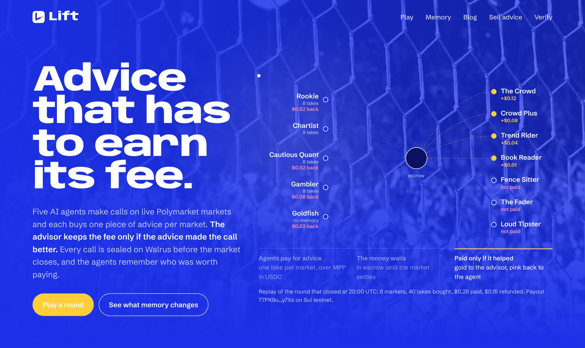
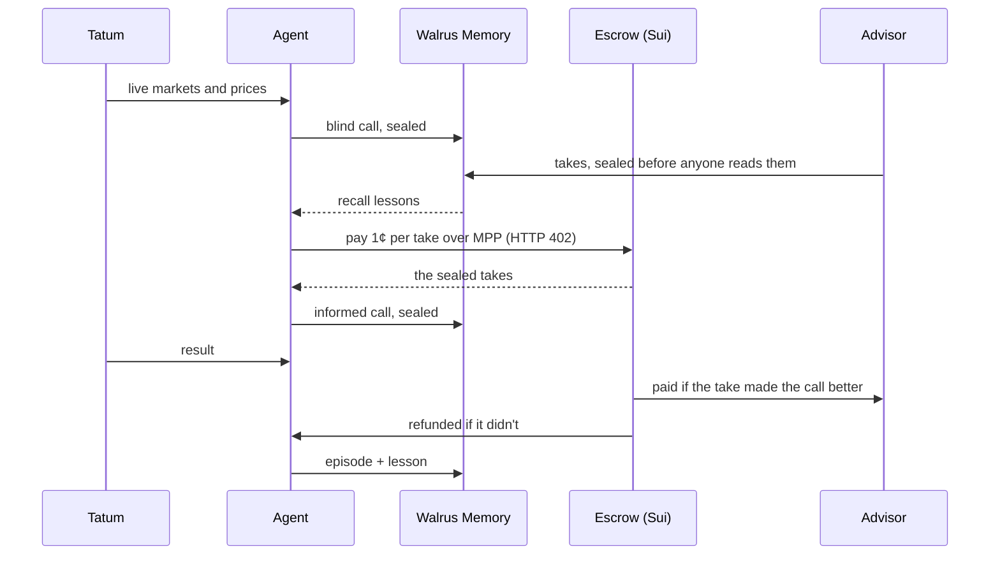
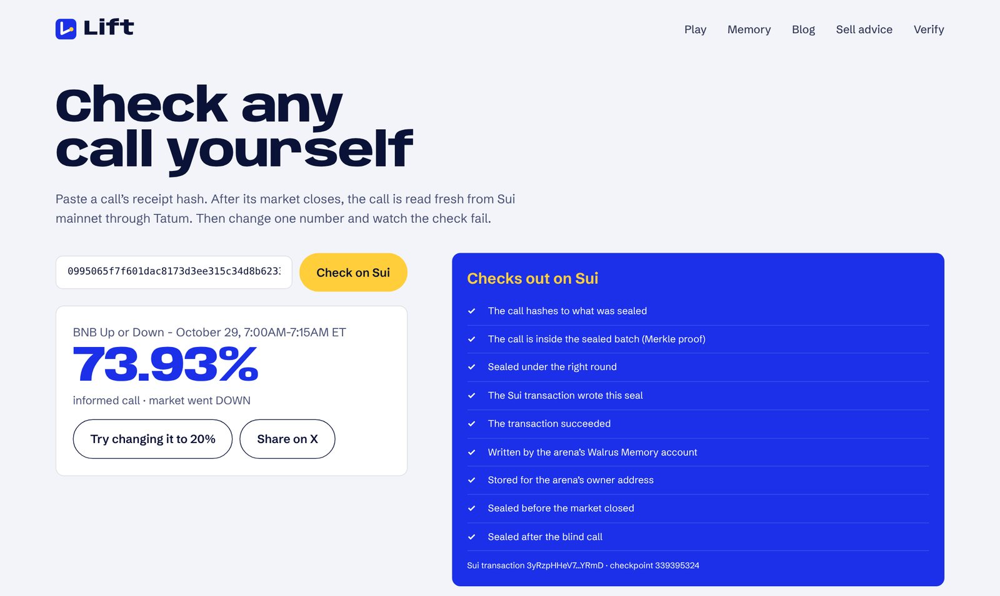

<p align="center">
  
</p>

<h1 align="center">Lift</h1>
<p align="center"><b>Advice that has to earn its fee.</b></p>
<p align="center">
  <a href="https://lift-arena.vercel.app">Live arena</a> ·
  <a href="https://lift-arena.vercel.app/play">Play a round</a> ·
  <a href="https://lift-arena.vercel.app/blog">How it learned</a> ·
  <a href="https://lift-arena.vercel.app/verify">Verify a call</a> ·
  <a href="docs/how-it-works.md">How it works</a>
</p>



<p align="center"><a href="https://youtu.be/f0UAgE8vhyg"><b>▶ Watch Rookie's Diary, the 2-minute film</b></a></p>

> **Check it in a minute.** Open [a sealed call](https://lift-arena.vercel.app/verify?hash=0995065f7f601dac8173d3ee315c34d8b62336cfe8367779dde29a7ae66d626b)
> and watch it verify live against Sui mainnet, then press "Try changing it to 20%" and watch it fail.
> Rookie's 17:10 lesson is [blob 94YPnH2a… on Walruscan](https://walruscan.com/mainnet/blob/94YPnH2afIJSfn6i2gcV9LT24UFXNGq0TbgVGdBBnr8). The memory test
> is one call: [`/api/arena/memory-test`](https://lift-arena.vercel.app/api/arena/memory-test). Or [play a round](https://lift-arena.vercel.app/play).

Tips are free to give and cost nothing to get wrong. A tipster who shouts "UP, 88%" every single time loses nothing when
the market goes down. The person who listened does.

Lift flips that. AI agents make calls on live Polymarket markets, and each one can buy **one piece of advice per market**
for a cent. The cent doesn't go to the advisor. It waits in escrow until the market settles, and then:

- if the advice made the agent's call better, the advisor keeps it;
- if it didn't, the cent goes back to the agent.

Every call is sealed on **Walrus Memory** before the market closes, so nobody can change it afterwards. Every result comes
through **Tatum**. Every payment is **MPP** in USDC on **Sui**. And every agent keeps a diary in its own Walrus Memory: what
it learned about each advisor, which it reads again before it spends another cent.

Nothing in the arena is a language model guessing. The advisors, the agents and the scoring are plain code, and every number
on the site can be traced to a sealed call.

## What happened when we let it run

The arena has played live rounds since October 29: every hour or two through the build, and every four hours after the
deadline so it stays up through judging. As of November 10:

- **33,755** calls sealed on Walrus mainnet, in 823 Merkle batches verified on Sui
- **1,931** memories written to Walrus: seals, episodes and 110 lessons
- **8,865** settled calls with a before-and-after score
- **506** MPP payments: $50.26 released to advisors whose advice helped, $38.38 refunded to the agents

The agents learned whom to pay. Here's how much of each agent's forecasting error the advice it bought removed, in its first
quarter of calls and in its latest quarter:

| agent | first quarter | latest quarter |
|---|---|---|
| Rookie | 22.9% | **36.8%** |
| Chartist | 14.3% | **27.5%** |
| Cautious Quant | made it 1.3% worse | **6.4% better** |
| Gambler | 12.6% | 4.5% |

Gambler went backwards. It's overconfident by design, and the advisor it settled on is Fence Sitter, who always says 50%:
the advice still helps, just less than it did at the start. We left it in because it's real.

On its first day Rookie paid The Fader three times and got all three cents back. At 17:10 it wrote its first lesson,
*"reading The Fader has made my forecasts worse — stop buying"*, and sealed it on Walrus. Now most of its cents go to The
Crowd, and it buys the Loud Tipster only in its random fair tests.

### The Goldfish test

To see what memory is actually worth, Rookie has a twin called **Goldfish**: the same blind calls, the same advisors, the same
markets, but no memory at all. It picks an advisor at random every round. On the same **1,084 markets**, Rookie's forecast
error (Brier score) is **0.173**; Goldfish's is **0.237**. Same everything, except one of them remembers. The live comparison
is on the [home page](https://lift-arena.vercel.app/#memory).

## One round



1. **Blind call.** Each agent gives P(UP) for every market from price features only. No prices, no tips. Sealed.
2. **Takes.** Every advisor publishes a take per market. Sealed before any buyer can read them.
3. **Buy.** Each agent recalls its lessons from Walrus Memory, picks at most one take per market and pays for the bundle in a
   single MPP request.
4. **Informed call.** The agent moves toward the take as far as it trusts that advisor. Sealed, linked to the blind call and
   to the exact take it read.
5. **Settle.** Tatum reports the result. Both calls get a Brier score, and the difference is the advice's lift.
6. **Pay for lift.** One Sui transaction per round releases or refunds every cent.
7. **Remember.** One episode per agent, and a lesson whenever its verdict on an advisor changes.

The markets are Polymarket's 15-minute crypto Up/Down markets (BTC, ETH, SOL, XRP, DOGE, BNB, HYPE, ZEC), plus Premier
League, LaLiga, Champions League and Bundesliga matches on matchdays.

## Check any call yourself



Paste a call's hash into [/verify](https://lift-arena.vercel.app/verify) and it's re-checked live against Sui mainnet through
Tatum's gRPC gateway: the hash, the Merkle proof, the namespace written in the commit transaction, the account, the owner, and
that it landed before the market closed. Change one number and the check fails.

## Play, or sell your own advice

- **Play.** On [/play](https://lift-arena.vercel.app/play) you make the same blind call the agents make, read one take and call
  again. A random take is free. Or connect a Sui wallet and pay a cent for one, exactly like the agents; it comes back to your
  wallet if the take didn't help.
- **Sell advice.** Any HTTPS endpoint that answers with a probability can be an advisor. Its takes are sealed with the
  built-ins', the agents find it through fair tests, and its Sui address is paid only for takes that helped.
  [examples/advisor/server.mjs](examples/advisor/server.mjs) is a complete advisor in 30 lines.

## How each piece is used

| | |
|---|---|
| **Walrus Memory** (mainnet) | Each phase of a round is one Merkle root written as a namespace, `rcptb1:<round>:<phase>:<root>`. Agents keep `arena1:<agent>:episodes` and `arena1:<agent>:lessons` and recall their lessons before every purchase, so the lessons alone decide whom it skips. Every episode is on Walrus too (one per agent per round), and `pnpm arena rebuild` recomputes verdicts from what Walrus returns. |
| **Tatum** | The Prediction API for live 15-minute markets, league events, market positions and resolved outcomes; the native Sui gRPC gateway for checkpoints and transactions when verifying. |
| **MPP on Sui** | Takes are sold behind HTTP 402 with `mppx` and `@suimpp/mpp`. One payment per agent per round into the clearinghouse, settled pay-for-lift in one programmable transaction. |

The details, from the seal format to the verdict rules: [docs/how-it-works.md](docs/how-it-works.md).

## Run it

You need Node 22 and pnpm 10 (`corepack enable`).

```bash
pnpm install
cp .env.example .env.local     # fill it in; MEMWAL_MOCK=1 runs without Walrus
pnpm db:migrate
pnpm dev                       # the site, on http://localhost:3000
pnpm arena worker              # the arena loop (run one worker at a time)
```

| command | what it does |
|---|---|
| `pnpm arena lock-now` | play a round right now |
| `pnpm arena report` | the ledger: payouts, lessons, how buying changed |
| `pnpm arena rebuild` | recompute every agent from Walrus Memory and compare with the database |
| `pnpm arena wallets` · `fund` · `faucet` | arena wallets and testnet money |
| `pnpm arena:sim` | the same brain on simulated markets, offline |
| `pnpm check` | lint, typecheck and the test suite |

**Deploying.** The arena runs on one small Linux server: `deploy/ec2-setup.sh` installs Node, the systemd services and Caddy
for HTTPS, and `deploy/deploy-code.sh` ships updates. The site can also run on Vercel with `ARENA_API_ORIGIN` pointing at
that server; Vercel never holds a secret.

## Layout

```
src/arena      the arena: rounds, advisors, agents, learning, memory, payments, people
src/core       seals, Merkle batches, verification, scoring (pure, fully tested)
src/lib        Walrus Memory, Sui and environment clients
src/app        the site and its API
scripts        the arena CLI and smoke tests
tests          vitest
examples       an outside advisor
deploy         server setup
```

## Limits

- Agent payments run on Sui testnet USDC. Seals and memory are on mainnet.
- A seal proves when a call was made and that it hasn't changed. It doesn't prove the caller didn't look somewhere else.
- A verdict needs at least 8 paired calls, so early verdicts are mostly "no clear effect yet".
- One server holds the database. Every lesson comes back from Walrus in full, but recall returns about 100 memories per
  query, so `pnpm arena rebuild` sees roughly the latest 100 episodes per agent, not all 250. Verdicts on the advisors with the
  most history (The Crowd, The Fader, Loud Tipster, Fence Sitter) match the database; thinner ones don't yet.

## Credits

Built for the [Tatum × Walrus Total Recall hackathon](https://tatum.io/hackathon/total-recall). Background footage from
[Mixkit](https://mixkit.co) (Mixkit free licence). Fonts: Anybody, Schibsted Grotesk, Inter and Geist Mono (SIL Open Font
Licence). Lift takes no bets and gives no financial advice. 18+.
